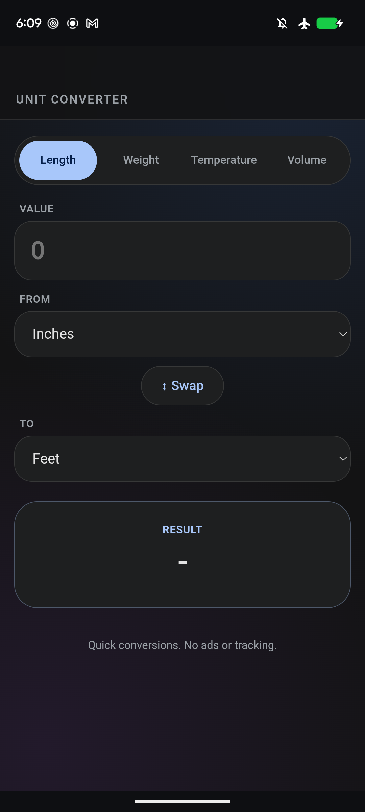

<div align="center">

# SafeConvert

**A clean, zero-ad Unit Converter on the surface. A discreet personal safety companion, trauma-informed resource guide, SHA-256 proof vault, and Bluetooth LE Help Beacon underneath.**

**Standalone App for Android (Google Pixel & Fold) · Apple (iPhone, Apple Fold & iPad) · Web Browser**

<br/>

[](https://ablation-tool.github.io/SafeConvert/)

<br/>

[](https://github.com/Ablation-Tool/SafeConvert/releases/download/v1.0.0/SafeConvert-v1.0.0-android.apk)
&nbsp;
[](https://github.com/Ablation-Tool/SafeConvert/releases/download/v1.0.0/SafeConvert-v1.0.0-apple-xcode.zip)
&nbsp;
[](https://github.com/Ablation-Tool/SafeConvert/releases/tag/v1.0.0)

<br/>

<sub><strong>Web Browser (no download):</strong> open <a href="https://ablation-tool.github.io/SafeConvert/"><code>ablation-tool.github.io/SafeConvert</code></a> in Safari, Chrome, Firefox, or Edge on any phone, tablet, or computer (tap <em>Add to Home Screen</em> on iPhone/iPad for full-screen standalone use).<br/><strong>Android APK:</strong> install <a href="https://github.com/Ablation-Tool/SafeConvert/releases/download/v1.0.0/SafeConvert-v1.0.0-android.apk"><code>SafeConvert-v1.0.0-android.apk</code></a> (<code>2.6 MB</code>, package <code>research.zoetic.safeconvert</code>, zero <code>INTERNET</code> permission).<br/><strong>Apple Xcode:</strong> open <a href="apple/SafeConvert.xcodeproj"><code>apple/SafeConvert.xcodeproj</code></a> or download <a href="https://github.com/Ablation-Tool/SafeConvert/releases/download/v1.0.0/SafeConvert-v1.0.0-apple-xcode.zip"><code>SafeConvert-v1.0.0-apple-xcode.zip</code></a> for iPhone, Apple Fold, and iPad.</sub>

<br/>



</div>

---

## How to Use SafeConvert

1. **Everyday Cover (Layer One):** SafeConvert opens as an ordinary, zero-ad, zero-tracking **Unit Converter** (Length, Weight, Temperature, Volume) with a neutral launcher icon and name (`SafeConvert`). Ordinary measurements (`0`, `0.5`, `112`, `100`, etc.) convert accurately and never accidentally trigger the safety layer.
2. **Open the Discreet Safety Companion (Layer Two):** Type any 3-digit `9`/`1` variant into the **Value** field:
   - Accepted codes: **`911`**, **`991`**, **`919`**, **`199`**, **`119`**, **`191`**, **`999`**, or **`111`**
   - Decimals and leading zeros also work: e.g., **`9.11`**, **`91.1`**, **`0.911`**, **`1.19`**, or **`9.99`**
3. **Instant Return to Cover (6 Triggers):** Tap **`✕ EXIT`**, tap the top bar, press **Back** or **`ESC`**, switch apps, lock the screen, or leave idle for 90 seconds. SafeConvert immediately cuts any read-aloud voice (`<10 ms`), stops Bluetooth LE beacons/scans, wipes ephemeral chat and drawing canvases, locks any passcode-protected vault, and snaps straight back to the Unit Converter.

---

## What Is Inside

| Feature | Details |
|:---|:---|
| **8 Regional Packs & 5 Languages** | Auto-detects locally + instant manual switch across **US (`911`)**, **Europe / EU (`112`, `116 111`, `116 006`)**, **UK (`999` / `112` + Silent Solution `55`, `0808 2000 247`)**, **Canada (`911`, `988`)**, **Australia (`000`, `1800RESPECT`)**, **Mexico / LATAM (`911`)**, **India (`112`, `181`, `1098`)**, and **Global (`112` / `911`)**. Interface in **English (`EN`)**, **Spanish (`ES`)**, **French (`FR`)**, **German (`DE`)**, and **Portuguese (`PT`)**. |
| **My Safe People** | Save up to 5 trusted contacts with custom distress messages or code words (e.g., *"Blue sky"*, *"Call me now"*) in app-private storage only (never added to your phone Contacts, excluded from cloud backup). One-tap pre-filled SMS or dialer. |
| **Post-Incident Care & Closest Help Spots** | Trauma-informed medical & forensic checklist (separate paper bags, SANE/SARC/ER care without requiring an immediate police report), native Maps handoffs (`geo:` / Apple Maps) for Nearest ER, Police Station, 24-Hour Pharmacy, and Public Library, plus opt-in one-shot GPS pin sharing. Confidential DV shelter addresses are never plotted on public maps. |
| **Kids Mode & Calming Studio** | **Young Child Easy Picture Mode** with large-icon cards and a full-width *"Show this screen to a safe adult"* card, plus **Breathe (4-4-6)**, **5-4-3-2-1 Calm**, auto-erasing **Calm Drawing Pad**, zero-timer **Easy Math**, and silent-by-default **Calm Stories** with an explicit sound-safety check before reading aloud. |
| **Private SHA-256 Proof Vault** | UTC-timestamped text notes plus opt-in `.m4a` audio and `.mp4` video stored strictly in app-private storage (never in your phone Gallery) with SHA-256 verification, optional 4-32 character `PBKDF2WithHmacSHA256` passcode lock that auto-locks on exit, and a 2-step explicit permission gate before sharing. |
| **Bluetooth LE Help Beacon & Mesh** | Works with zero cell signal or Wi-Fi: 22-byte signed BLE packets with 15-minute rotating SHA-256 ephemeral tags (`Blind E2EE Relay` and `Local SOS Mesh`). Starts strictly OFF, enforces a hard 30-minute auto-expiry, shuts off instantly on exit, and supports 1-tap Rotate / Revoke All Keys. |

---

## Privacy & Anti-Surveillance Architecture

- **Zero `INTERNET` Permission on Android:** SafeConvert does not even request `android.permission.INTERNET` in [`AndroidManifest.xml`](android/app/src/main/AndroidManifest.xml). Its `WebView` sets `setBlockNetworkLoads(true)` and blocks every request outside local bundled assets.
- **Screenshot & App-Switcher Protection:** Android dynamically activates `WindowManager.LayoutParams.FLAG_SECURE` whenever Layer Two is open (blocking screenshots, screen recording, and Recents thumbnails). Apple immediately kills voice output, exits to cover, and applies a thick `UIVisualEffectView` blur shield on `willResignActiveNotification`.
- **Zero Cloud Backup:** Android sets `android:allowBackup="false"`, `android:fullBackupContent="false"`, and strict [`data_extraction_rules.xml`](android/app/src/main/res/xml/data_extraction_rules.xml) exclusion. Apple includes [`PrivacyInfo.xcprivacy`](apple/SafeConvert/PrivacyInfo.xcprivacy) declaring zero tracking and zero collected data.
- **Full Technical Specification:** See [`SAFECONVERT.md`](SAFECONVERT.md).

---

## Install & Build From Source

### Web Browser (Instant, Any Device)
Open **[`https://ablation-tool.github.io/SafeConvert/`](https://ablation-tool.github.io/SafeConvert/)** directly in any mobile or desktop browser. On iPhone or iPad, tap **Share -> Add to Home Screen** to install as a full-screen standalone app immediately.

### Android (Google Pixel, Android Phones & Foldables)
- **Direct Download:** Install **[`SafeConvert-v1.0.0-android.apk`](https://github.com/Ablation-Tool/SafeConvert/releases/download/v1.0.0/SafeConvert-v1.0.0-android.apk)** (verify against `SafeConvert-v1.0.0-android.apk.sha256` on the [Release page](https://github.com/Ablation-Tool/SafeConvert/releases/tag/v1.0.0)).
- **Build & Test From Source:**
  ```bash
  cd android
  ./gradlew testDebugUnitTest assembleDebug lintDebug
  ```

### Apple (iPhone, Apple Fold & iPad)
- **Xcode Project:** Open [`apple/SafeConvert.xcodeproj`](apple/SafeConvert.xcodeproj) in Xcode 16+ (bundle ID `research.zoetic.safeconvert`, iOS 17+, `TARGETED_DEVICE_FAMILY = "1,2"` for iPhone, Apple Fold, and iPad), choose your Apple Development Team, and press Run.
- **Swift Core Tests:**
  ```bash
  cd shared
  swift test
  ```

---

## Verified Hardware & Automated Tests

| Suite | Target | Result |
|:---|:---|:---|
| **Android Live Hardware Espresso (`SafeConvertActivityTest`)** | Google Pixel 7 (`research.zoetic.safeconvert`) | **`10/10` PASS** (`7.7s`) |
| **Android JVM Unit Tests** (`SafeBeaconMeshTest`, `SafeConvertIntentTest`, `SafeEvidenceStoreTest`, `SafeVaultLockTest`) | Local JVM | **`12/12` PASS** |
| **Android Lint (`lintDebug`)** | Android API 26-36 | **`0` Errors** |
| **Apple Swift Core Tests (`SafeConvertCoreTests`)** | Swift 6.1.3 (`SafeConvertCore`) | **`5/5` PASS** |

---

## Honest Safety Boundaries & Credits

- **Not Medical, Legal, or Emergency Dispatch Advice:** SafeConvert provides local safety information, calming tools, SHA-256 timestamped documentation, and short-range Bluetooth LE signaling. It is not counseling, legal representation, or a guarantee of physical safety. Calls and texts still depend on your device, carrier, signal, and local emergency services.
- **Bluetooth LE Scope:** Peer-to-peer BLE typically reaches ~30-80 m between active SafeConvert phones depending on walls and terrain. It does not use Apple's proprietary global Find My network.
- **Recording Consent Laws:** Audio and video recording consent laws vary by state and country. Record only when safe and lawful.
- **Credits:** The original SafeConvert concept is credited to **ExileKingdom / Nuclide**. Standalone Android, Apple (iOS / iPadOS / Apple Fold), and Web implementation engineered independently under **GPL-3.0**. Companion project to [Zoe](https://github.com/Ablation-Tool/zoe).
